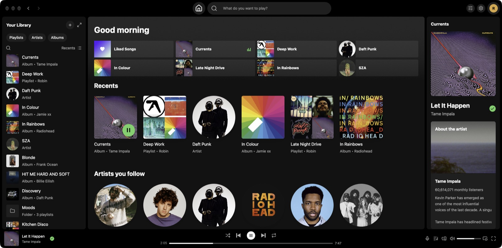
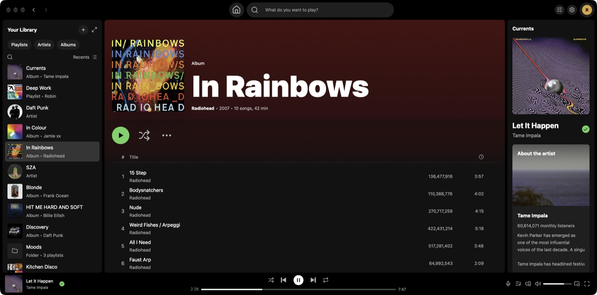
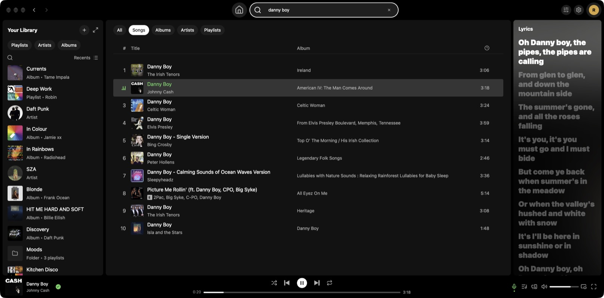

<p align="center">
  
</p>

<h1 align="center">Turntable</h1>

<p align="center">
  A fast, native Spotify player for macOS, Linux and Windows.<br>
  Built with <a href="https://www.gpui.rs/">GPUI</a> and <a href="https://github.com/librespot-org/librespot">librespot</a>. Requires Spotify Premium.
</p>



## Features

- Your whole library: playlists, folders, albums, artists and Liked Songs
- Search
- Create and edit playlists
- Now Playing panel, full-screen view and miniplayer
- Synced lyrics
- Spotify Connect: play here or on your other devices
- Equalizer, loudness normalization and crossfade
- Streaming quality up to 320 kbps
- Media keys and keyboard shortcuts

<p>
  
  
</p>

## Performance

|               |       Idle | Playing | CPU playing |
|---------------|-----------:|--------:|------------:|
| Turntable     |      47 MB |   65 MB |        0.0% |
| Spotify       |     808 MB |  ~1 GB  |        4.4% |
| [Spotifast](https://github.com/crmne/spotifast)¹ | 100–250 MB |         |             |

Windows: 13 MB idle, 14 MB playing.²<br>
<sub>¹ From [spotifast.rocks](https://spotifast.rocks). ² Excludes GPU memory, which macOS counts.</sub>

## Install

```sh
brew install --cask khanhphxm/tap/turntable   # macOS
brew install khanhphxm/tap/turntable          # Linux
```

Or download the macOS disk image, Windows installer or Linux package from
[Releases](https://github.com/khanhphxm/turntable/releases).

## Build from source

Requires Rust 1.90+.

```sh
git clone https://github.com/khanhphxm/turntable.git
cd turntable
cargo run --release -p turntable
```

**Linux** also needs native headers (Debian/Ubuntu; same packages as CI):

```sh
scripts/install-linux-deps.sh
```

**Windows** builds with the MSVC toolchain.

## Privacy

Turntable talks only to Spotify. Your sign-in stays on your computer.

Turntable is an unofficial client that uses Spotify's internal (non-public) interfaces.
It can break when Spotify changes them; use it at your own risk under
[Spotify's terms](https://www.spotify.com/legal/end-user-agreement/).

## License

[MIT](LICENSE). Icons from [Lucide](https://lucide.dev) (ISC).
Third-party components retain their own licenses; see [THIRD_PARTY_NOTICES](THIRD_PARTY_NOTICES).
Turntable is not affiliated with, endorsed or sponsored by Spotify. Spotify is a trademark of
Spotify AB.
