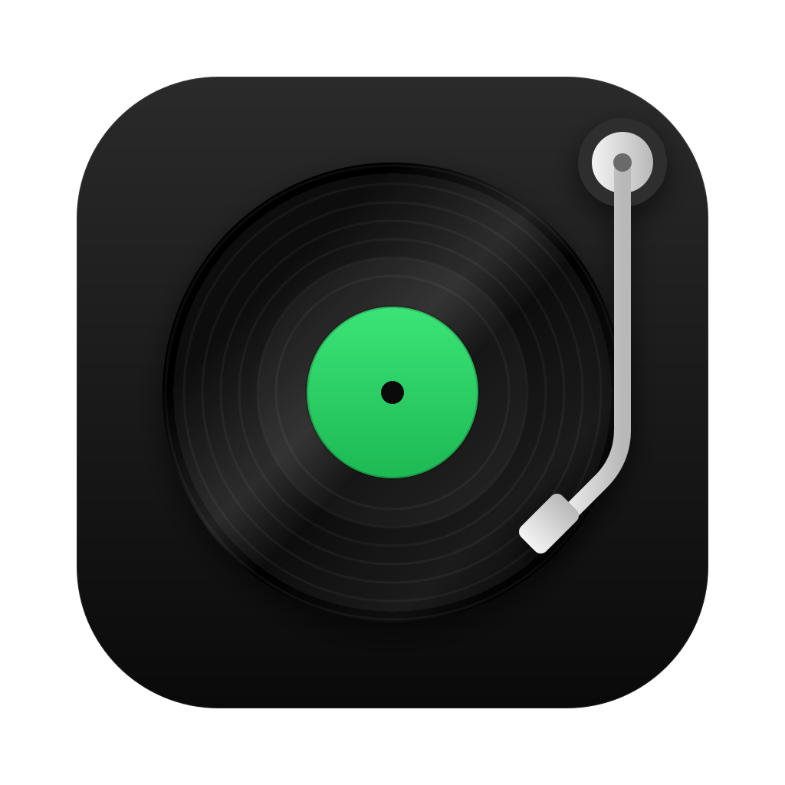

<p align="center">
  
</p>

<h1 align="center">Turntable</h1>

<p align="center">
  A fast, native Spotify player for macOS, Linux and Windows.<br>
  Built with <a href="https://www.gpui.rs/">GPUI</a> and <a href="https://github.com/librespot-org/librespot">librespot</a>. Requires Spotify Premium.
</p>

<!-- screenshot: home -->

## Features

- Your whole library: playlists, folders, albums, artists and Liked Songs
- Search
- Create and edit playlists
- Now Playing panel, full-screen view and miniplayer
- Synced lyrics
- Spotify Connect: play here or on your other devices
- Equalizer, loudness normalization and crossfade
- Media keys and keyboard shortcuts

<!-- screenshot: album -->
<!-- screenshot: lyrics -->

## Performance

|               |       Idle | Playing | CPU playing |
|---------------|-----------:|--------:|------------:|
| Turntable     |      47 MB |   65 MB |        0.0% |
| Spotify       |     808 MB |  ~1 GB  |        4.4% |
| Spotifast¹    | 100–250 MB |         |             |

Windows: 13 MB idle, 14 MB playing.²<br>
<sub>¹ Self-reported. ² Excludes GPU memory, which macOS counts.</sub>

## Install

```sh
brew install --cask khanhphxm/tap/turntable   # macOS
brew install khanhphxm/tap/turntable          # Linux
```

Or download the macOS disk image, Windows installer or Linux package from
[Releases](https://github.com/khanhphxm/turntable/releases).

## Build from source

Requires Rust 1.90+.

```sh
git clone https://github.com/khanhphxm/turntable.git
cd turntable
cargo run --release -p turntable
```

**Linux** also needs (Debian/Ubuntu names):

```sh
sudo apt install clang cmake pkg-config libssl-dev libdbus-1-dev libasound2-dev \
  libfontconfig1-dev libfreetype6-dev libwayland-dev libxkbcommon-dev libxkbcommon-x11-dev libxcb-xkb-dev
```

**Windows** builds with the MSVC toolchain.

The UI uses the platform's built-in font family, without enumerating installed fonts at startup.
Artwork is decoded into physical-pixel buckets matching row thumbnails, 164 px shelf covers,
page headers and the default right panel at 1x and 2x display scales.
Only visible render regions retain full-size artwork. Offscreen covers release their GPU atlas
entries and keep small previews plus encoded sources in a 4 MiB warm cache, so recent Back
visits show artwork immediately while full-resolution pixels are restored. Older covers reload
from the on-disk cache; reclamation does not add an idle timer.

## Privacy

Turntable talks only to Spotify. Your sign-in stays on your computer.

Turntable is an unofficial client that uses Spotify's internal (non-public) interfaces.
It can break when Spotify changes them; use it at your own risk under
[Spotify's terms](https://www.spotify.com/legal/end-user-agreement/).

## License

[MIT](LICENSE). Icons from [Lucide](https://lucide.dev) (ISC).
Third-party components retain their own licenses; see [THIRD_PARTY_NOTICES](THIRD_PARTY_NOTICES).
Turntable is not affiliated with, endorsed or sponsored by Spotify. Spotify is a trademark of
Spotify AB.
